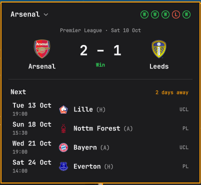

# Touchline

Your football team in the [Omarchy](https://omarchy.org) bar: the next fixture at a
glance, the live score while a match is on, and a popup with the latest result, recent
form, a countdown to kick-off and the fixtures coming up. Works for any club or national
team ESPN covers, men's and women's, in every competition they play.



## Install

```sh
omarchy plugin add https://github.com/kristjaningi/omarchy-touchline.git --enable
```

## Usage

- **Pick your team:** on first run the bar says *Pick a team*. Click it, type a few letters
  of the team's name, and choose from the list. To change team later, click the team name
  at the top of the popup, or press Enter while the popup is open.
- **Bar:** a ball and the next opponent (`@Bayern · Wed`; `@` means away), switching to
  the live score during a match (`ARS 1–0 Lille 63'`).
- **Popup:** the latest result with crests and score (`Win · 4–3 pens` after a shootout),
  the last five results, and the next fixtures with kick-off time, (H)/(A) and
  competition. Clicking a match opens it on ESPN. Escape closes the popup.
- **Middle click** refetches.
- **Shell commands:**

  ```sh
  omarchy-shell kristjaningi.touchline toggle    # also open, close
  omarchy-shell kristjaningi.touchline pick      # open straight into the team picker
  omarchy-shell kristjaningi.touchline refresh
  ```

## Configure

Move it to another part of the bar:

```sh
omarchy bar move kristjaningi.touchline --section right
```

Settings live in the bar settings, or on the widget's entry in
`~/.config/omarchy/shell.json`:

| Key | Default | |
|---|---|---|
| `teamId` | none | Set by the team picker. The team's ESPN id, e.g. `359` for Arsenal. |
| `showLabel` | `true` | Off leaves just the ball; a live score still shows. |
| `fixtures` | `4` | Upcoming fixtures in the popup, 1–8. |
| `autoRefresh` | `true` | Off fetches only at startup, on opening the popup, and on middle click. |

## Requirements

- Omarchy with the Quickshell-based `omarchy-shell` bar (Omarchy 4).
- `curl`, which Omarchy already includes.
- Internet access to ESPN (see below). Nothing else is installed or run.

## Data and network

Everything comes from ESPN's public, keyless site API at `site.api.espn.com`, with team
search at `site.web.api.espn.com` and crests from `a.espncdn.com`; nothing else is
contacted, and nothing about you is sent. It fetches the team's schedule every
30 minutes, and every minute from 15 minutes before kick-off until the match ends, when
it also reads the competition's scoreboard for the live score. Failed fetches retry,
then fall back to every 5 minutes. Each monitor's bar fetches on its own, as Omarchy's
weather widget does.

ESPN's API is undocumented and unofficial: it can change without notice, and if it
does, the widget stops updating until the plugin is fixed.

All text from ESPN is length-limited, stripped of control and direction-changing
characters, and shown as plain text. Requests are fixed HTTPS URLs passed to `curl` as
arguments, never through a shell. The only thing it writes is your team choice: to its
own entry in `shell.json`, and to `~/.local/state/kristjaningi.touchline.json` so the
team survives the widget being disabled and re-enabled.

## Update

```sh
omarchy plugin update kristjaningi.touchline
```

## Remove

```sh
omarchy plugin remove kristjaningi.touchline
```

This disables the widget and deletes the plugin folder. To also forget your team choice:

```sh
rm -f ~/.local/state/kristjaningi.touchline.json
```

## Development

```sh
omarchy plugin validate ~/.config/omarchy/plugins/kristjaningi.touchline
node --test tests/
```

## License

MIT. The bar and popup wiring is adapted from Omarchy's built-in weather widget.
